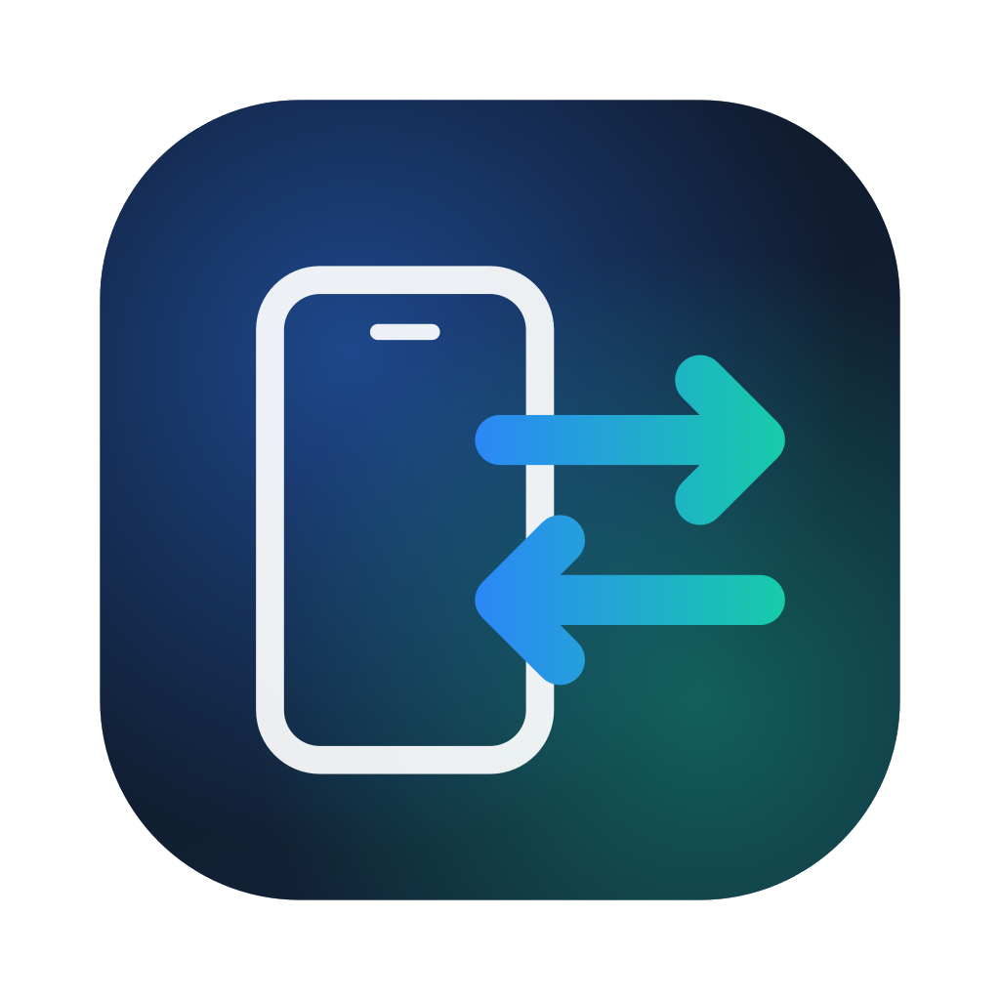
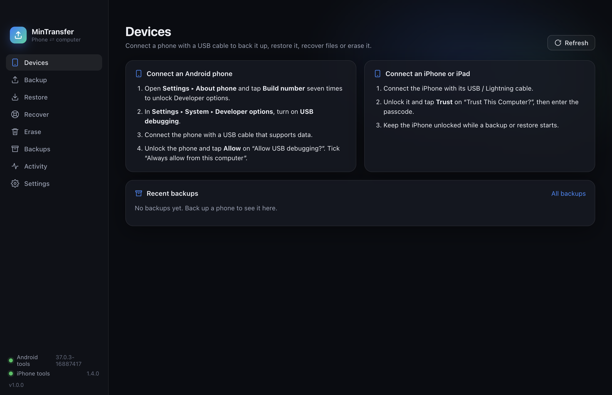
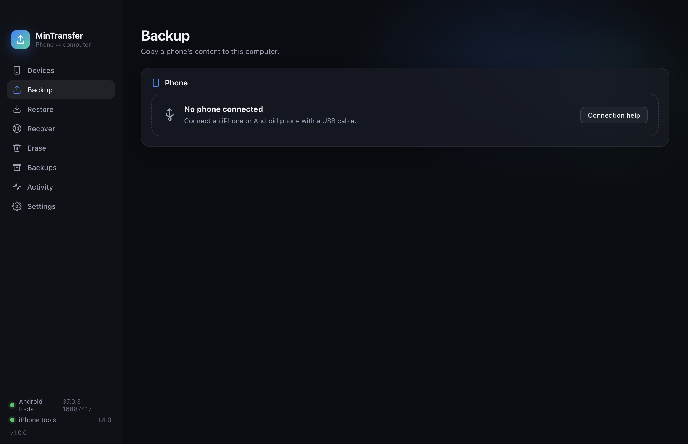
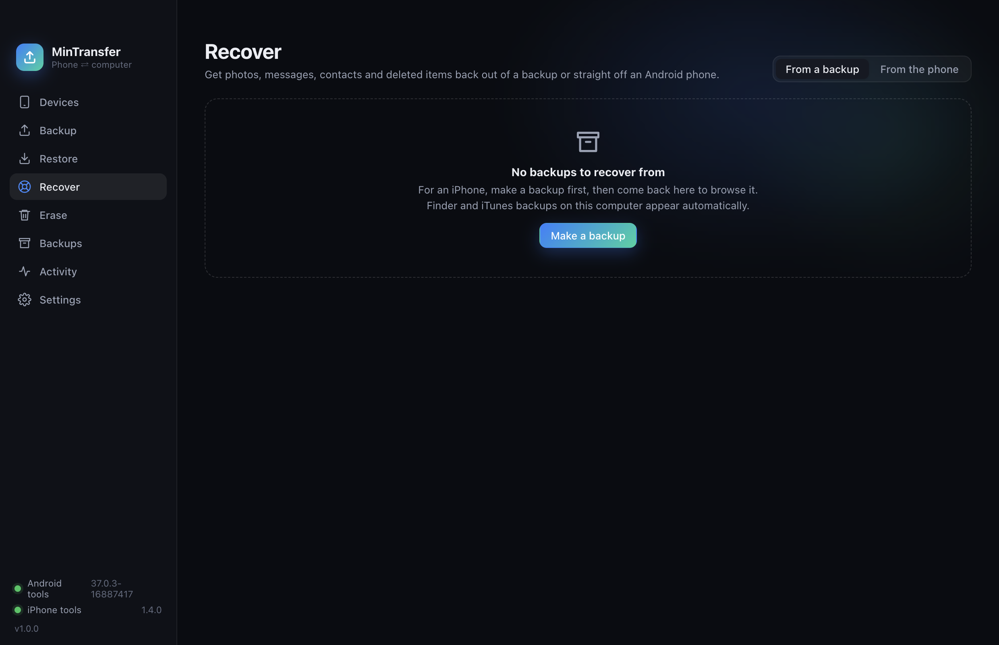
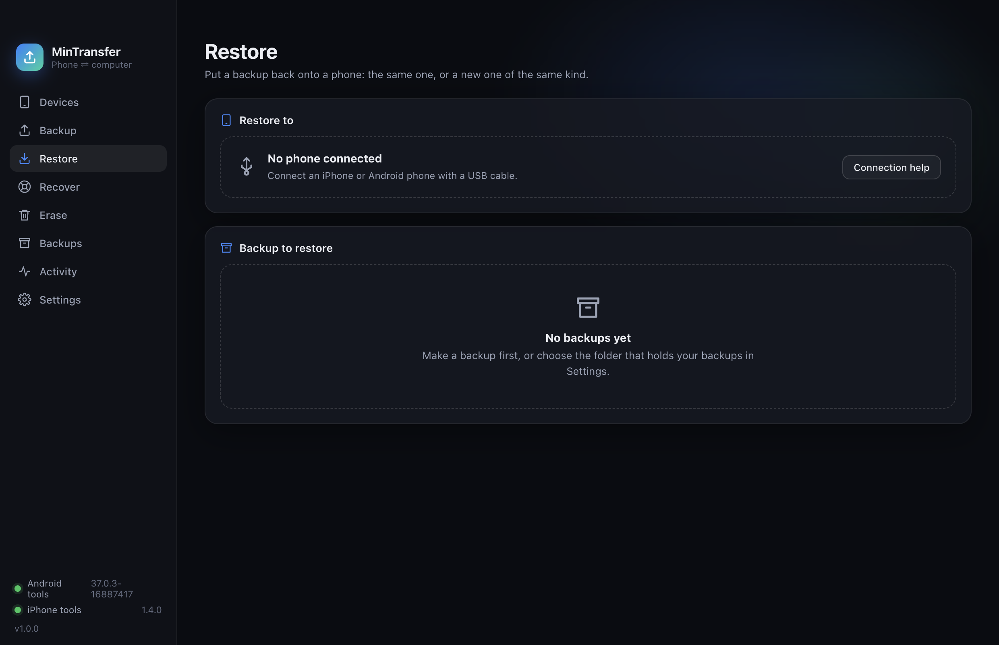
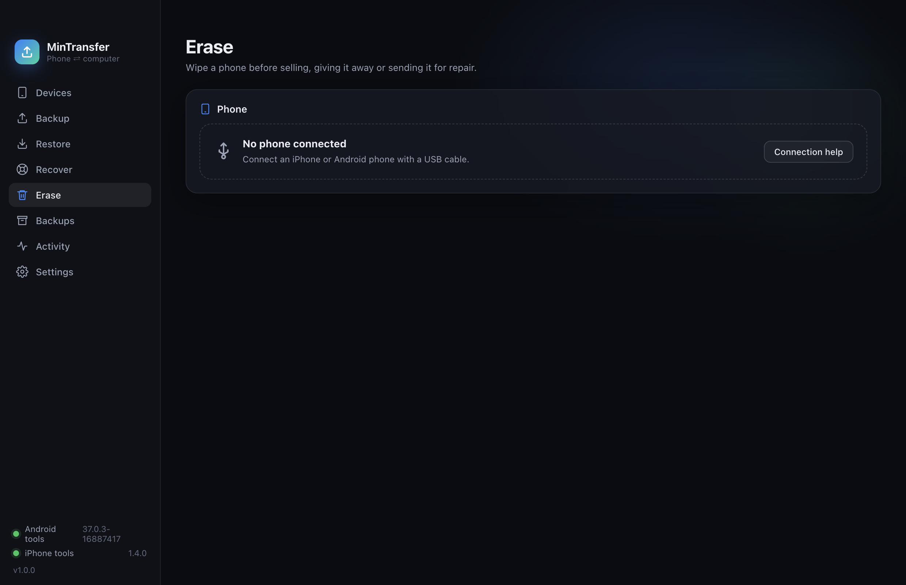
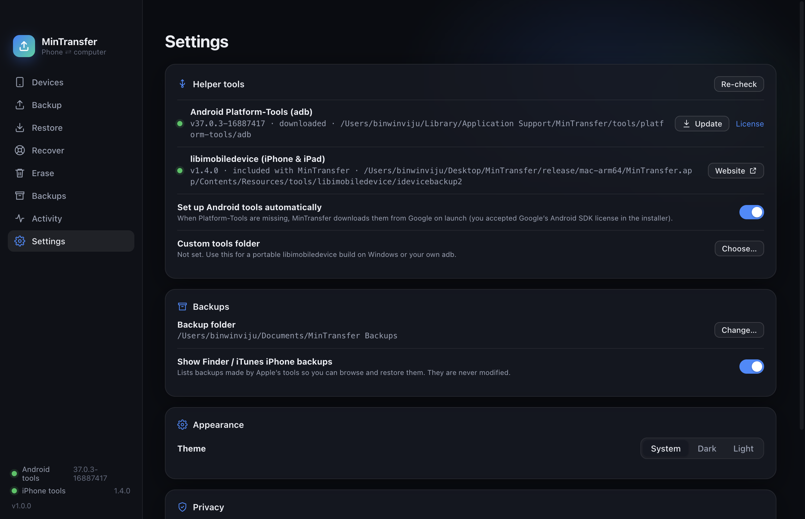
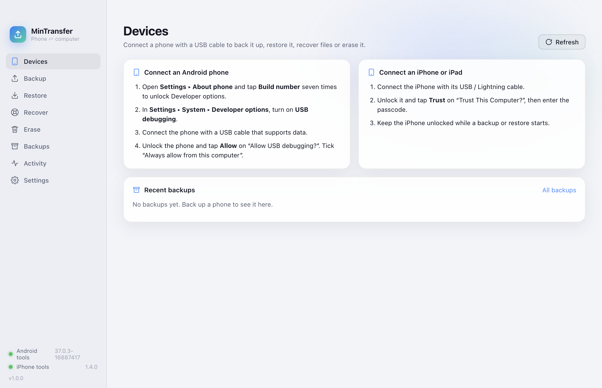

<div align="center">



# MinTransfer

**Back up, restore, recover and erase iPhone and Android phones from your computer.**

A desktop app for macOS and Windows that moves everything off a phone and back again:<br>
full iPhone backups, Android photos / apps / contacts, recovery of deleted photos, messages and notes, and safe erasing.<br>
Everything runs locally. No accounts, no cloud, no subscription.

[](https://github.com/Binwin6724/MinTransfer/releases/latest)




</div>

---

## Why MinTransfer?

Apps like iMazing, Dr.Fone or Smart Switch show how useful a "phone ⇄ computer" tool is. MinTransfer is an open-source take on that idea that stays honest about what each platform allows:

- 📱 **One app for both platforms.** iPhone / iPad and Android, on Mac and Windows, with the same four actions: **Backup, Restore, Recover, Erase**.
- 🍎 **Real iPhone backups.** MinTransfer speaks Apple's own MobileBackup2 protocol (through [libimobiledevice](https://libimobiledevice.org/)), so a backup is the same complete, restorable backup Finder and iTunes make, optionally encrypted.
- 🤖 **Android without root.** Photos, videos, music, documents, downloads, WhatsApp media, installed apps (including split APKs) and contacts as a vCard, over Google's own `adb`.
- ♻️ **Recovery that actually works.** Browse any unencrypted iPhone backup (yours or Finder's/iTunes') and save photos, **Recently Deleted** photos, messages with attachments, contacts, call history, notes (including **Recently Deleted**), voice memos and WhatsApp chats. On Android, scan the phone's trash, gallery recycle bins and thumbnail caches for deleted photos.
- 🧹 **Erase before you sell.** Wipe storage, remove apps and reboot to recovery for Android; guided erase or recovery-mode factory restore for iPhone. Always behind a typed confirmation and a "you have no backup" warning.
- 🧰 **Nothing extra to install.** The iPhone tools ship inside the installer, and Google's Android tools are set up automatically the first time MinTransfer starts.
- 🔒 **Private.** No account, no telemetry. The only network request is the optional download of Google's Platform-Tools. Backup passwords go straight to the phone and are never stored.

## Features

| | |
|---|---|
| **Devices** | Live detection of every connected iPhone, iPad and Android phone (USB or Wi-Fi): name, model, OS version, battery, storage, serial/UDID, backup encryption. Clear guidance when a phone needs “Trust This Computer” or “Allow USB debugging”, and a one-click trust request for iPhones. |
| **Backup** | **iPhone:** full Finder-compatible backup with progress, optional encryption (password confirmed, never saved). **Android:** pick Photos, Videos, Music & audio, Documents, Downloads, WhatsApp media, Apps (APK), Contacts (vCard), Call log, SMS, or the entire internal storage. Timestamps are preserved; free space is checked; each backup is a normal, portable folder. |
| **Restore** | **iPhone:** restore any MinTransfer, Finder or iTunes backup to the same or a new iPhone (settings, system files, restart, encrypted backups, and a “keep the backup untouched” copy mode). **Android:** push files back without overwriting newer ones, reinstall apps (with splits), import contacts, and rescan the media library. |
| **Recover** | **From a backup:** photos, Recently Deleted photos, contacts (.vcf + .csv), Messages (SMS/iMessage CSV, per-chat transcripts and attachments, including iOS 16+ messages stored only in `attributedBody`), call history, notes with full text (Recently Deleted too), voice memos, WhatsApp messages and media, or every raw file. Android backups extract per category. **From an Android phone:** finds Android 11+ trash, Samsung / Xiaomi / OPPO / OnePlus gallery recycle bins, file-manager trash and thumbnail caches, grouped by source with select / recover. |
| **Erase** | **iPhone:** step-by-step on-phone erase, or one click to restart it into recovery mode for a factory restore with Finder / Apple Devices (Apple doesn't let computers trigger "Erase All Content and Settings" over USB). **Android:** delete the contents of chosen shared-storage folders, uninstall all user apps, and restart into recovery for a full factory reset. Typed `ERASE` confirmation, backup check, Find My / FRP warnings. |
| **Backups** | Library of MinTransfer backups plus (read-only) Finder / iTunes / Apple Devices backups, with size, date, encryption, completeness, per-category counts, browse, show in Finder/Explorer and delete (to the Trash / Recycle Bin). |
| **Activity** | Every operation runs as a cancellable job with progress, a status line and a full log. The computer is kept awake while a job runs; quitting mid-transfer asks first. |
| **Settings** | Status of the bundled iPhone tools and auto-installed Android tools (re-download, or use your own folder), Apple USB-driver check on Windows, backup folder, Finder-backup listing, theme (system / dark / light), logs. |

## Screenshots

<table>
<tr>
<td><br><sub><b>Backup</b>: pick a phone and what to copy</sub></td>
<td><br><sub><b>Recover</b>: from a backup or straight off an Android phone</sub></td>
</tr>
<tr>
<td><br><sub><b>Restore</b>: back to the same phone or a new one</sub></td>
<td><br><sub><b>Erase</b>: typed confirmation and backup check</sub></td>
</tr>
<tr>
<td><br><sub><b>Settings</b>: helper tools and backup folder</sub></td>
<td><br><sub><b>Light theme</b></sub></td>
</tr>
</table>

<sub>Screenshots were captured from the packaged app (`--capture-screenshots`) on a Mac with no phone connected.</sub>

## Download & install

Get the installer for your computer from the **[latest release](https://github.com/Binwin6724/MinTransfer/releases/latest)**:

| Computer | File |
|---|---|
| Mac with Apple silicon (M1 and later) | `MinTransfer-x.y.z-mac-arm64.dmg` |
| Mac with an Intel processor | `MinTransfer-x.y.z-mac-x64.dmg` |
| Windows 10 / 11 (64-bit) | `MinTransfer-x.y.z-win-x64-setup.exe` |

**Helper tools are handled for you:**
- **iPhone / iPad:** the libimobiledevice tools are **included in the installer**, nothing to install.
- **Android:** the first time MinTransfer starts, it **automatically downloads Google's Platform-Tools (adb)** from `dl.google.com` (~15 MB). Google's license is shown in the installer; you can turn this off in Settings.

### macOS (12 Monterey or later)
1. Open the DMG, accept the license, and drag **MinTransfer** into **Applications**.
2. **First launch:** release builds are ad-hoc signed but not notarized, so right-click MinTransfer and choose **Open**, or run:
   ```bash
   xattr -dr com.apple.quarantine /Applications/MinTransfer.app
   ```
3. *Optional:* to list backups made by Finder, give MinTransfer **Full Disk Access** (System Settings ▸ Privacy & Security). macOS protects that folder.

### Windows 10 / 11 (x64)
1. Run the setup file and accept the license. The installer isn't code-signed yet, so SmartScreen may warn: *More info ▸ Run anyway*.
2. **For iPhones:** install the free **[Apple Devices](https://apps.microsoft.com/detail/9NP83LWLPZ9K)** app (or iTunes) from the Microsoft Store. It provides Apple's USB driver, which can't be bundled. MinTransfer tells you if it's missing.
3. Some Android phones (Samsung, Xiaomi…) also need their maker's USB driver.

### Preparing the phone
- **Android:** Settings ▸ About phone ▸ tap *Build number* 7× ▸ Developer options ▸ **USB debugging** on ▸ connect ▸ **Allow**.
- **iPhone:** connect ▸ unlock ▸ **Trust** ▸ enter the passcode. Keep it unlocked while a backup or restore starts. Turn **Find My** off before restoring.

## How it works

```
                    ┌──────────────── MinTransfer (Electron main process) ────────────────┐
  iPhone ──USB──►   │ libimobiledevice: idevice_id · ideviceinfo · idevicepair ·          │
  (usbmuxd)         │                   idevicebackup2 (backup/restore) · ideviceenterrecovery │
                    │                                                                      │──► Backup folder
  Android ─USB──►   │ adb: devices · getprop · pull/push · pm · content query · reboot     │    (portable)
                    │                                                                      │
                    │ Backup reader: Manifest.db + sql.js → Photos.sqlite, AddressBook,    │──► Recovered files
                    │   sms.db, CallHistory, NoteStore (gzip+protobuf), WhatsApp           │    (.vcf .csv .txt
                    └──────────────────────────────────────────────────────────────────────┘     photos, media)
                                    ▲ typed IPC (contextIsolation, sandbox)
                              React UI (renderer)
```

* **Helper tools are run without a shell.** Arguments are always passed as arrays; Android shell paths are single-quoted; package names are validated; erase only accepts known folder names.
* **iPhone backups are standard.** A MinTransfer iPhone backup can be restored by Finder/iTunes, and Finder/iTunes backups can be browsed and restored by MinTransfer.
* **Android backups are plain folders:** `files/` mirrors `/sdcard`, `apps/<package>/*.apk`, `data/contacts.vcf`, `data/call-log.csv`, `data/messages.csv`, plus `mintransfer.json` describing the backup.
* **Recovery reads, never writes.** Backups are opened read-only; extraction copies into a new folder.

More detail: [docs/ARCHITECTURE.md](docs/ARCHITECTURE.md) · [docs/LIMITATIONS.md](docs/LIMITATIONS.md)

## Build from source

Requirements: Node.js 22+. On macOS, `swift` (Xcode Command Line Tools) only if you want to regenerate the icon.

```bash
git clone https://github.com/Binwin6724/MinTransfer.git
cd MinTransfer
npm install
npm test            # 41 tests, including an end-to-end iOS backup extraction
npm run dev         # Vite + Electron (uses libimobiledevice from Homebrew / PATH)

# Bundle the iPhone tools into vendor/tools before packaging:
brew install libimobiledevice dylibbundler && npm run bundle:ios-tools   # macOS
# Windows: in an MSYS2 UCRT64 shell with mingw-w64-ucrt-x86_64-libimobiledevice installed:
#   bash scripts/bundle-ios-tools-win.sh

npm run dist:mac    # → release/MinTransfer-<version>-mac-<arch>.dmg
npm run dist:win    # → release/MinTransfer-<version>-win-x64-setup.exe
```

## Project layout

```
shared/        Pure, unit-tested logic: adb & libimobiledevice parsers, vCard/CSV export,
               binary plist / protobuf / typedstream decoders, types
electron/      Main process: device services (android.ts, ios.ts), iOS backup reader,
               backup library, job runner, tool discovery & download, IPC
src/           React UI: Devices, Backup, Restore, Recover, Erase, Backups, Activity, Settings
tests/         Vitest unit and integration tests
scripts/       Build, dev server and icon scripts
```

## Honest notes

* **No tool can recover data that a modern phone has truly deleted.** iPhones and Android phones encrypt storage per file; once a file is purged its key is gone. MinTransfer recovers what still exists: trash, recycle bins, thumbnail caches, Recently Deleted, and backups made earlier.
* **Android app data** (game progress, app logins) is not backed up. Android only lets system backup tools (Google One, Smart Switch) read it. SMS and call-log export works only on phones that still allow USB debugging to read them.
* **Encrypted iPhone backups** can be made and restored, but not browsed in Recover yet.
* **Erase** can't fully factory-reset either platform from a computer by itself: Android wipes storage and apps and restarts into recovery for you to confirm; iPhone is erased on the phone or factory-restored from recovery mode with Finder / Apple Devices.
* See [docs/LIMITATIONS.md](docs/LIMITATIONS.md) for the full list.

## Releasing

Push a version tag. CI builds the Apple-silicon and Intel DMGs and the Windows installer (each with the iPhone tools bundled), checks the tools run, and publishes a GitHub release:

```bash
git tag v1.0.1 && git push origin v1.0.1
```

## Contributing

Issues and pull requests are welcome. See [CONTRIBUTING.md](CONTRIBUTING.md).

## License

[MIT](LICENSE) © Binwin Viju. The installers include unmodified [libimobiledevice](https://libimobiledevice.org/) tools (LGPL-2.1+), run as separate programs; Google's [Android SDK Platform-Tools](https://developer.android.com/tools/releases/platform-tools) are downloaded from Google, not redistributed. See [THIRD_PARTY_NOTICES.md](THIRD_PARTY_NOTICES.md). Not affiliated with Apple or Google.
